<div align="center">

# 🏭 PLC · HMI 금속/비금속 선별 자동화 라인

**Mitsubishi Q-PLC + Pro-face HMI로 만든 "공급 → 드릴 가공 → 송출 → 컨베이어 → 금속 선별 배출" 자동화 스테이션**


<br/><br/>

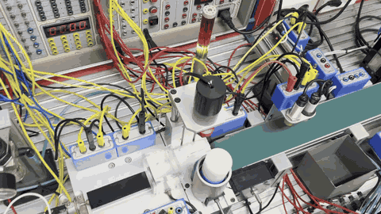
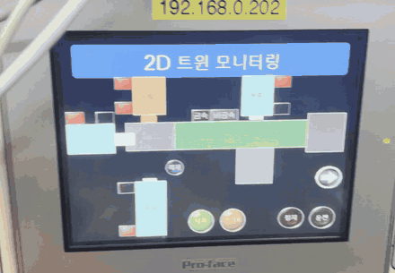

<sub>▲ 왼쪽: 실제 장비 1사이클 · 오른쪽: 같은 공정을 HMI <b>2D 트윈 모니터링</b> 화면으로 실시간 표시</sub>

</div>

<br/>

## 📌 한눈에 보기

| 항목 | 내용 |
|---|---|
| **과정** | AI스마트제조융합인재양성과정 · 교과목 *스마트통합운영제어실습* (훈련 80H / 평가 4H) |
| **기간** | 2026.10.12 – 2026.11.04 (릴레이 시퀀스 → PLC 래더 → HMI 연동 → 실기 평가) |
| **형태** | 개인 실습 · 과정에서 제공한 교육용 장비 사용 |
| **장비** | WSB-Q93 PLC 트레이너 (MELSEC Q, CPU Q02H, **QJ71E71-100** 이더넷) · Pro-face **AGP-3400T** · 공압 실린더 4축 + 드릴 모터 + 컨베이어 + 금속 근접센서 |
| **툴** | GX Works2 (래더) · GP-Pro EX 4.08 (작화) · PH-Lab (릴레이/공압 시뮬레이션) · Excel (I/O 매핑) |
| **결과물** | 257스텝 래더 · HMI 3화면(타이틀 / 2D 트윈 / 상세 세팅) · 이더넷 통신 설정 · 시운전 영상 |

<br/>

## 🧭 시스템 구성

```text
 ┌──────────────── HMI ─────────────────┐            ┌─────────────── PLC (MELSEC Q) ───────────────┐
 │ Pro-face AGP-3400T  192.168.0.202    │  Ethernet  │ Q02H CPU + QJ71E71-100     192.168.0.102     │
 │  · 시작/정지/원복/카운트 리셋 (M100~)   │◀──────────▶│  TCP · Unpassive · Port 5000 · Binary code   │
 │  · 타이머 설정값 입력   (D20~D24)      │            │                                              │
 │  · 2D 트윈 애니메이션   (D30~D35)      │            │  X0~XD  ◀── 리드스위치 8 · 매거진 · 금속센서 · PB │
 │  · 금속/비금속/합계 카운트 (D0/D2/D4)   │            │  Y20~Y2B ──▶ 솔레노이드 7 · 드릴모터 · 컨베이어 · 경광등 │
 └──────────────────────────────────────┘            └──────────────────────────────────────────────┘
```

<table>
  <tr>
    <td width="50%">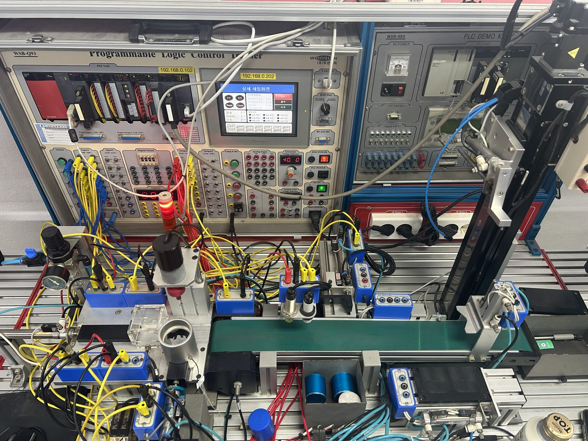</td>
    <td width="50%">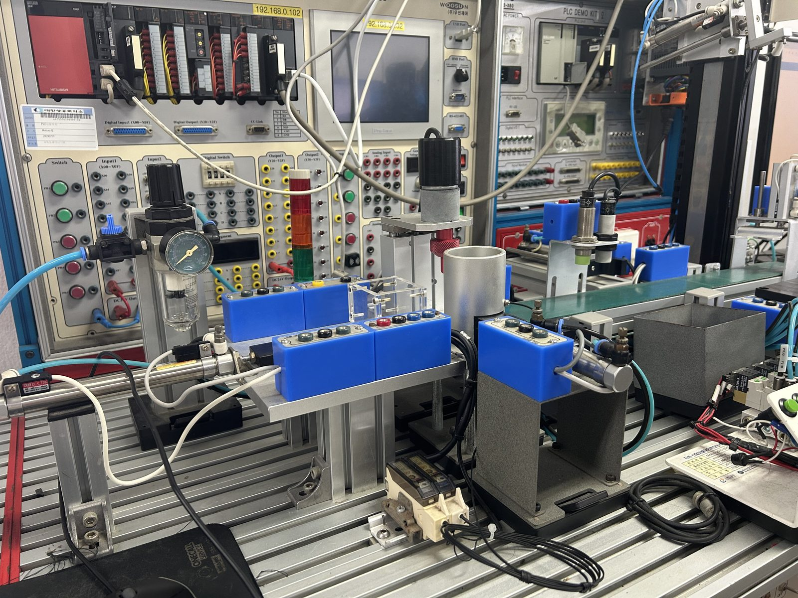</td>
  </tr>
  <tr>
    <td align="center"><sub>PLC 트레이너 + 공정 스테이션 배선 완료 상태</sub></td>
    <td align="center"><sub>공급 → 드릴 → 송출 → 컨베이어 → 배출 라인</sub></td>
  </tr>
</table>

<br/>

## 🔁 공정 흐름

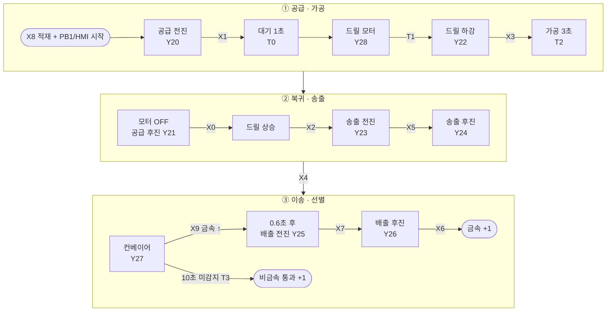

<br/>

## 🔌 I/O 매핑

<table>
<tr><td valign="top">

| 입력 | 표기 |
|---|---|
| `X0` | 공급 후진 센서 |
| `X1` | 공급 전진 센서 |
| `X2` | 드릴 상승 센서 |
| `X3` | 드릴 하강 센서 |
| `X4` | 송출 후진 센서 |
| `X5` | 송출 전진 센서 |
| `X6` | 배출 후진 센서 |
| `X7` | 배출 전진 센서 |
| `X8` | 매거진 적재 감지 |
| `X9` | 금속 감지 |
| `XA` | 비금속 감지 |
| `XB` | PB1 (시작) |
| `XC` | PB2 (정지) |
| `XD` | PB3 (정지 · 원복) |

</td><td valign="top">

| 출력 | 표기 |
|---|---|
| `Y20` | 공급 전진 (SOL1) |
| `Y21` | 공급 후진 (SOL2) |
| `Y22` | 드릴 하강 (SOL5, 편솔) |
| `Y23` | 송출 전진 (SOL3) |
| `Y24` | 송출 후진 (SOL4) |
| `Y25` | 배출 전진 (SOL6) |
| `Y26` | 배출 후진 (SOL7) |
| `Y27` | 컨베이어 |
| `Y28` | 드릴 모터 |
| `Y29` | 적색 램프 (정지) |
| `Y2A` | 황색 램프 (모터 가동) |
| `Y2B` | 녹색 램프 (운전) |

</td><td valign="top">

| HMI 디바이스 | 용도 |
|---|---|
| `M100` | HMI 시작 |
| `M102` | HMI 정지 |
| `M103` | HMI 원복(리셋) |
| `M104` | 카운트 리셋 |
| `D0 / D2 / D4` | 금속 / 비금속 / 합계 |
| `D20 ~ D24` | 타이머 설정값 (0.1s) |
| `D30 ~ D33` | 실린더 위치 0·50·100 |
| `D35` | 컨베이어 위 공작물 위치 |
| `M70 ~ M73` | 공정 단계 표시 |

</td></tr>
</table>

<br/>

## 🪜 래더 설계 — "완료 비트 래치" 스텝 시퀀스

257스텝 래더는 모든 공정 단계를 **같은 두 줄 패턴**으로 반복합니다. 단계마다 *완료 비트*를 하나씩 두고, 동작 출력은 `이전 단계 완료 AND NOT 현재 단계 완료`일 때만 켜집니다.

```text
 ── 이전완료 ──┬── 완료센서 ──┬──────────( 현재완료 )      ← 센서가 들어오면 완료 비트 자기유지
              └── 현재완료 ──┘
 ── 이전완료 ──── /현재완료 ─────────────( 동작출력 )      ← 완료되는 순간 출력 OFF, 다음 단계로
```

- **한 출력 = 한 단계.** 출력 코일이 중복되지 않고, 모니터링 화면에서 *어느 완료 비트까지 켜졌는지*만 보면 멈춘 위치를 바로 찾을 수 있습니다.
- **운전 비트 `M10` 하나가 모든 단계의 뿌리.** `M5(OFF)`가 들어오면 `M10`이 떨어지면서 전체 시퀀스가 한 번에 초기화됩니다.
- **원점 인터록 `M0`** = 공급·드릴·송출·배출이 모두 후진/상승 위치일 때만 시작 가능.
- **원복 `M40`** = 정지 상태에서 PB3/HMI 리셋을 누르면 복동 실린더를 후진 위치까지 되돌리고, 원점이 잡히면 스스로 해제.

| # | 단계 | 출력 | 완료 비트 ← 조건 |
|---|---|---|---|
| 0 | 운전 시작 | `M10` | (PB1 ∨ HMI 시작) ∧ 매거진 X8 ∧ 원점 M0 |
| 1 | 공급 전진 | `Y20` | `M11` ← X1 |
| 2 | 대기 | `T0 (D20)` | `M12` ← T0 |
| 3 | 드릴 모터 회전 | `Y28` (M12 ~ M15) | `M13` ← T1 (D21) |
| 4 | 드릴 하강 | `Y22` | `M14` ← X3 |
| 5 | 가공 | `T2 (D22)` | `M15` ← T2 |
| 6 | 공급 후진 | `Y21` | `M16` ← X0 |
| 7 | 드릴 상승 (편솔 복귀) | — | `M17` ← X2 |
| 8 | 송출 전진 | `Y23` | `M18` ← X5 |
| 9 | 송출 후진 | `Y24` | `M19` ← X4 |
| 10 | 컨베이어 | `Y27` | `M20` ← X9 상승펄스 (금속) / `T3 (D23)` 타임아웃 (비금속) |
| 11 | 배출 대기 | `T4 (D24)` | `M21` ← T4 |
| 12 | 배출 전진 | `Y25` | `M22` ← X7 |
| 13 | 배출 후진 | `Y26` | `M23` ← X6 → 금속 카운트, 사이클 종료 |

👉 스텝별 래더 캡처와 해설: **[docs/01_ladder_walkthrough.md](docs/01_ladder_walkthrough.md)**

<br/>

## 🖥️ HMI 작화 (GP-Pro EX)

<table>
  <tr>
    <td width="33%">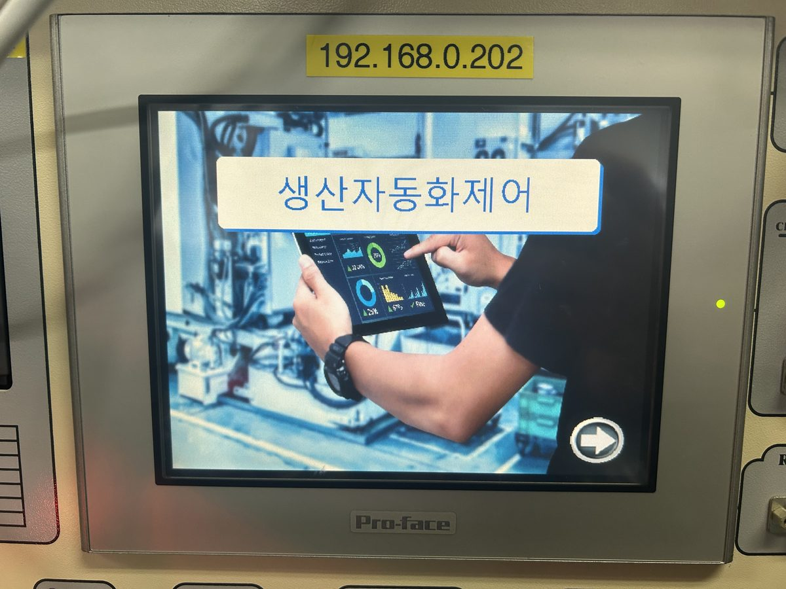</td>
    <td width="33%">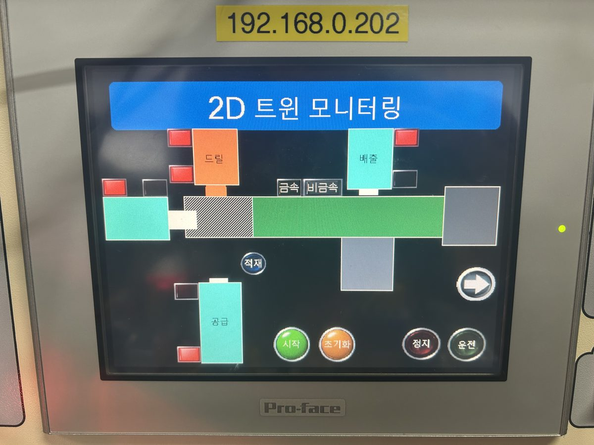</td>
    <td width="33%">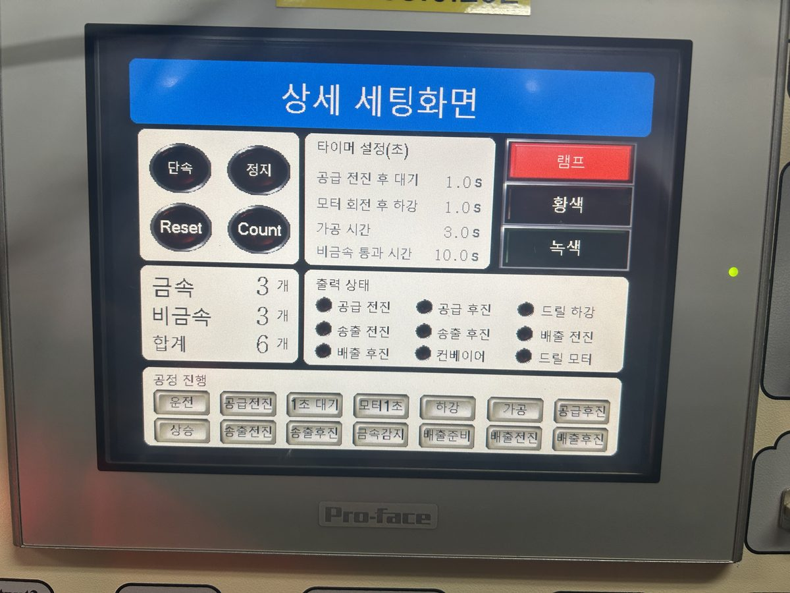</td>
  </tr>
  <tr>
    <td align="center"><sub><b>① 타이틀</b><br/>다음 화면 전환 버튼</sub></td>
    <td align="center"><sub><b>② 2D 트윈 모니터링</b><br/>실린더 4축 · 공작물 위치를 센서값 기반 애니메이션으로 표시</sub></td>
    <td align="center"><sub><b>③ 상세 세팅</b><br/>타이머 설정 · 카운트 · 출력 상태 · 공정 진행 표시</sub></td>
  </tr>
</table>

<div align="center">
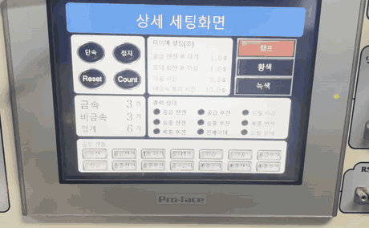
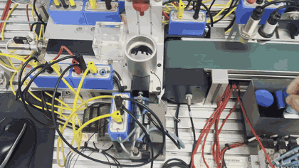
</div>

**2D 트윈은 PLC에서 위치값을 만들어 HMI에 넘기는 방식입니다.**

```text
SM400 ── MOV K50  D30      실린더가 이동 중이면 50 (중간)
  ├─ X0 ─ MOV K0   D30      후진 센서 ON  → 0
  └─ X1 ─ MOV K100 D30      전진 센서 ON  → 100      (D31 드릴 · D32 송출 · D33 배출도 같은 구조)

Y27 ─ SM410↑ ─ [< D35 K100] ─ INC D35     컨베이어가 도는 동안 공작물 위치를 0→100으로 증가
M21 ───────────────────────── MOV K62 D35  금속 감지 후 배출 위치(62)에 정지
```

👉 화면 설계와 디바이스 연결 상세: **[docs/02_hmi_and_comm.md](docs/02_hmi_and_comm.md)**

<br/>

## 🌐 PLC ↔ HMI 이더넷 통신

| 구분 | 설정 |
|---|---|
| PLC (GX Works2) | 네트워크 파라미터 Ethernet · IP `192.168.0.102` · 바이너리 코드 · **RUN 중 쓰기 허가** · 오픈 설정 `TCP / Unpassive / Port 5000` |
| HMI (GP-Pro EX) | 접속기기 `Mitsubishi Q/QnA Series Ethernet` · IP `192.168.0.202` → PLC `192.168.0.102:5000` · Timeout 3s · Retry 2 · *Connected to Q Series E71 I/F Module* |

<table>
  <tr>
    <td width="40%">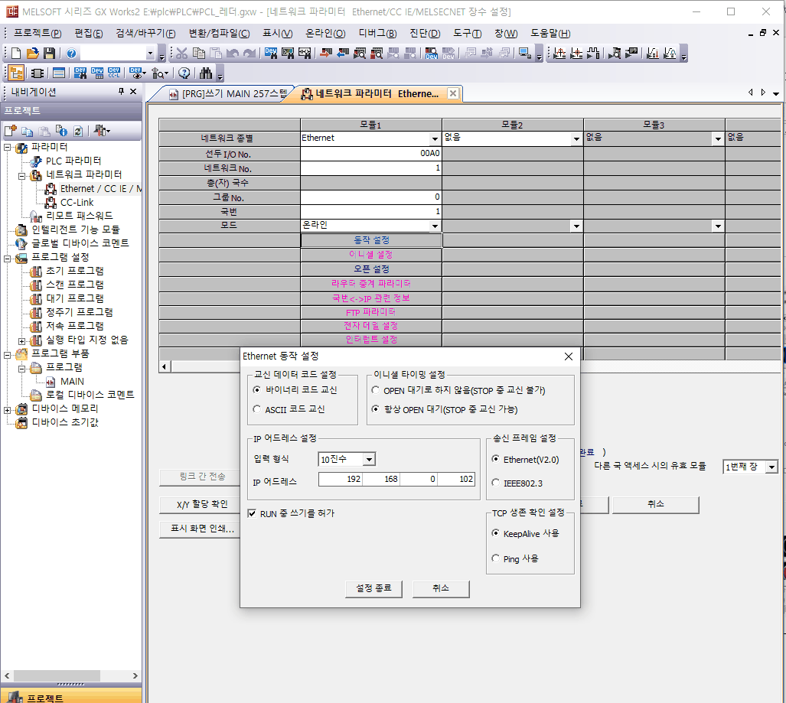</td>
    <td width="30%">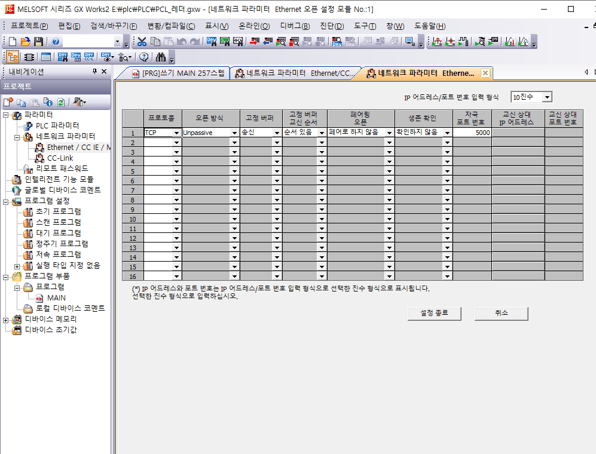</td>
    <td width="30%">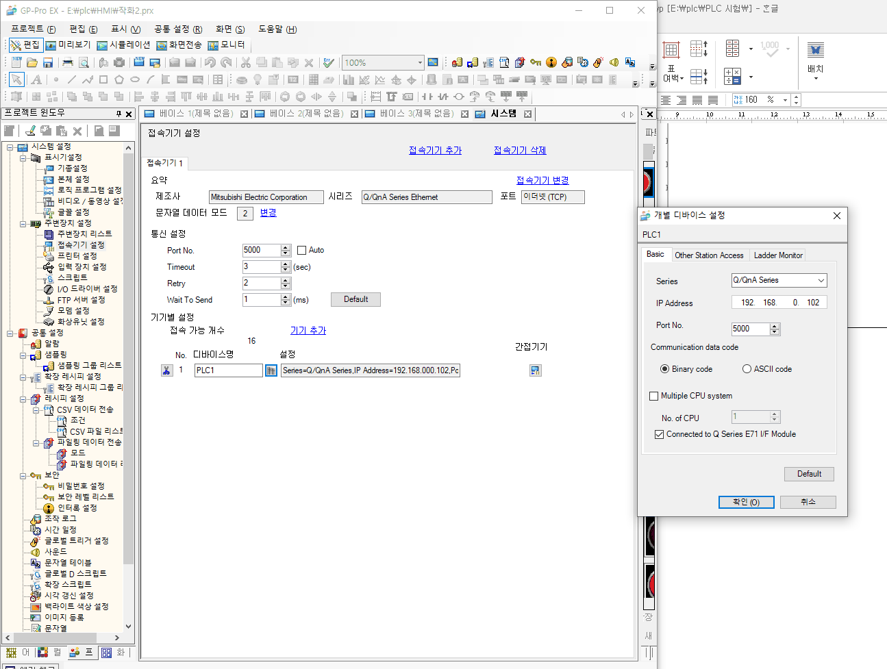</td>
  </tr>
</table>

<br/>

## 🔍 셀프 리뷰 — 잘한 점 & 다음에 고칠 점

| ✅ 잘 된 설계 | 🛠 개선 포인트 |
|---|---|
| 완료 비트 래치 구조로 **출력 중복 없이** 13단계를 일관되게 작성 | **정지 = 전체 리셋.** `M5`가 `M10`을 끊어 공정 중간에 멈추면 재개 없이 원복부터 다시 해야 함 → 일시정지 래치 / `MC·MCR`로 *출력만 차단하고 단계 비트는 유지*하는 구조로 개선 |
| 원점 인터록(`M0`)과 원복 시퀀스(`M40`)를 운전 시퀀스와 분리 | **비금속 판정이 "10초간 금속 미감지" 타임아웃.** `XA` 비금속 센서를 쓰지 않아 공작물이 걸려도 비금속으로 카운트될 수 있음 → XA 확인 + 미감지 알람 |
| 타이머 설정값을 `D20~D24`로 빼서 **HMI에서 현장 조정** 가능 (`SM402`로 초기값) | **단계별 타임아웃 알람 부재.** 실린더 센서가 안 들어오면 무한 대기 → 수위 제어 실습에서 만든 *센서 이상 검출* 로직을 단계마다 적용 |
| 센서 상태로 위치값을 만들어 **HMI 2D 트윈** 구현 | 평가 버전은 **1사이클(단속) 운전.** 이전 연습 버전의 연속 운전 래치(PB2 연속 / PB3 연속정지)를 통합 |
| `X9` 금속 감지를 **상승 펄스**로 받아 채터링·중복 카운트 방지 | 경광등 황색이 모터 상태만 표시 → 알람 시 점멸(`SM412`) 등 상태 코드 정의 |

<br/>

## 📚 기초부터 쌓은 과정

| 날짜 | 단계 | 내용 |
|---|---|---|
| 10.12 – 10.14 | **릴레이 시퀀스 (PH-Lab)** | a/b접점 AND·OR, 자기유지, 인터록, 선입·후입 우선(퀴즈쇼) 회로, 온/오프 딜레이 타이머, 카운터, 편솔·양솔 실린더, `A+B+B-A-` · `A+B+A-B-` 시퀀스, 연속/단속/정지 |
| 10.14 – 10.19 | **GX Works2 래더 입문** | X/Y/M 16진 주소 체계, 특수릴레이(SM400·SM402·SM412), 타이머+모터, 적산 타이머 |
| 10.19 | **수위 제어 + 센서 이상 검출** | 저·중·고수위 3센서 → 펌프 2대·램프·부저(1초 점멸), *물리적으로 불가능한 센서 조합*을 에러로 잡아 Ready 인터록 |
| 10.19 – 10.26 | **공정 스테이션 I/O 매핑 · 시퀀스** | 엑셀 매핑 리스트 작성 → 동작 순서 플로우 → 단계별 래더 |
| 11.02 – 11.03 | **PLC ↔ HMI 연동** | GP-Pro EX 작화, E71 이더넷 통신, 비트 스위치·램프·데이터 표시기 |
| 11.04 | **실기 평가** | 터치패널 작화 + PLC 제어 래더 + 통신 설정 (4시간) |

👉 기초 실습 정리: **[docs/03_basics.md](docs/03_basics.md)**

<br/>

## 🎬 영상

| 파일 | 내용 |
|---|---|
| [01_full_cycle_overview.mp4](videos/01_full_cycle_overview.mp4) | 위에서 본 1사이클 전체 (공급 → 가공 → 송출 → 컨베이어 → 배출) |
| [02_cycle_closeup_and_hmi_twin.mp4](videos/02_cycle_closeup_and_hmi_twin.mp4) | 공작물 투입부터 근접 촬영 + HMI 2D 트윈 동기화 |
| [03_hmi_setting_screen.mp4](videos/03_hmi_setting_screen.mp4) | 상세 세팅 화면에서 단속 운전 · 램프 · 카운트 |
| [04](videos/04_panel_operation_a.mp4) · [05](videos/05_panel_operation_b.mp4) · [06](videos/06_panel_operation_c.mp4) | 트레이너 패널 푸시버튼 조작과 경광등 |

<br/>

## 📁 폴더 구조

```text
PLC_HMI_Automation/
├── src/
│   ├── 01_metal_sorting_line/     # 평가 제출본 래더(.gxw, 257스텝) · HMI 작화(.prx) · 연습 버전
│   ├── 02_plc_hmi_link/           # 첫 PLC-터치패널 연동 실습
│   ├── 03_gxworks2_basics/        # 수위 제어 · 우선 회로 · 타이머 · 실린더 래더
│   └── 04_phlab_relay_sequence/   # PH-Lab 릴레이·공압 시퀀스 (.phl)
├── docs/                          # 래더 해설 · HMI/통신 · 기초 실습
├── media/                         # gif · 사진 · 래더/설정 캡처 · 과제 사양
└── videos/                        # 시운전 영상 (720p)
```

> `.gxw`는 **GX Works2**, `.prx`는 **GP-Pro EX**, `.phl`은 **PH-Lab**에서 열 수 있습니다.

<br/>

## 💡 배운 점

- **시퀀스는 "단계를 쪼개는 일"** — 동작 하나하나에 완료 조건을 붙이니 래더가 길어져도 읽히고, 고장 위치가 보였습니다.
- **현장은 정상 동작보다 예외가 어렵다** — 정지·원복·센서 고장 같은 예외 처리가 실제 설비 래더의 대부분이라는 걸 체감했고, 다음 목표로 남겼습니다.
- **HMI는 PLC 데이터를 "보이게" 만드는 층** — 센서 비트를 위치값으로 바꿔 2D 트윈을 만들면서, 데이터 설계(D 레지스터 배치)가 화면 설계보다 먼저라는 걸 배웠습니다.
