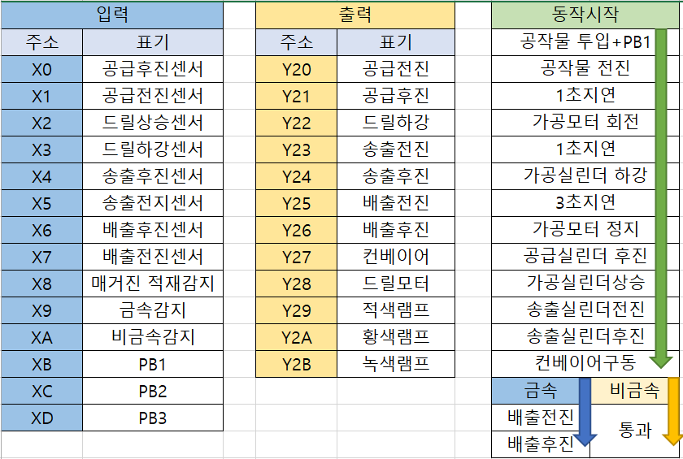
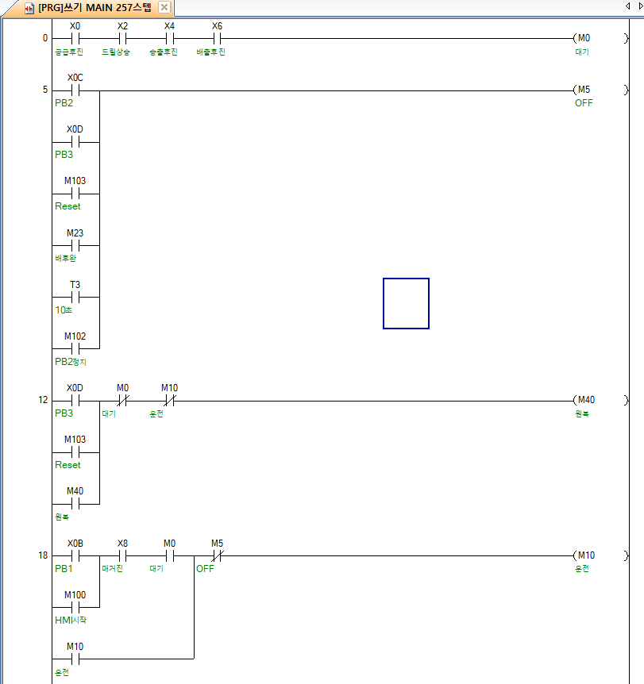
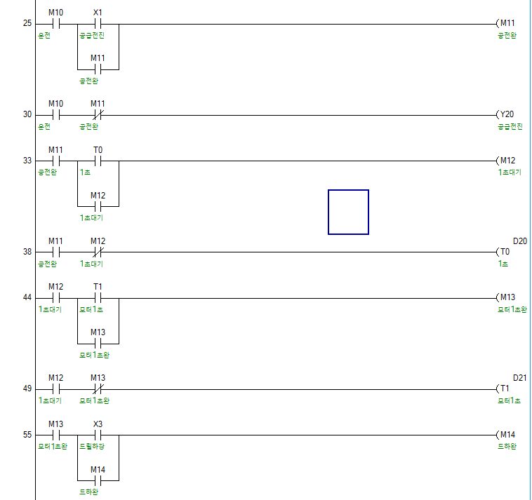
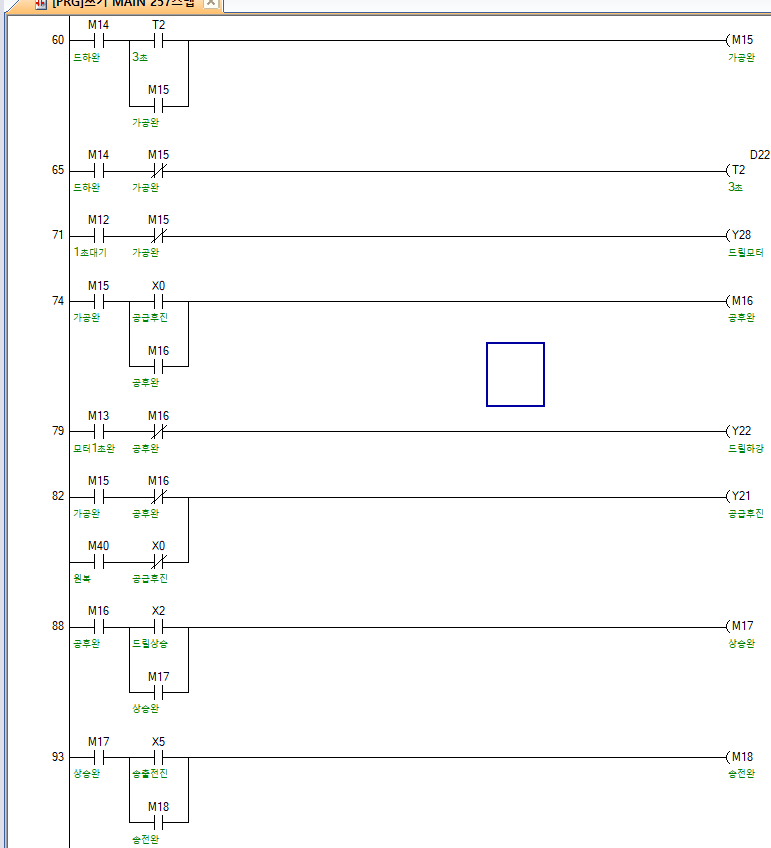
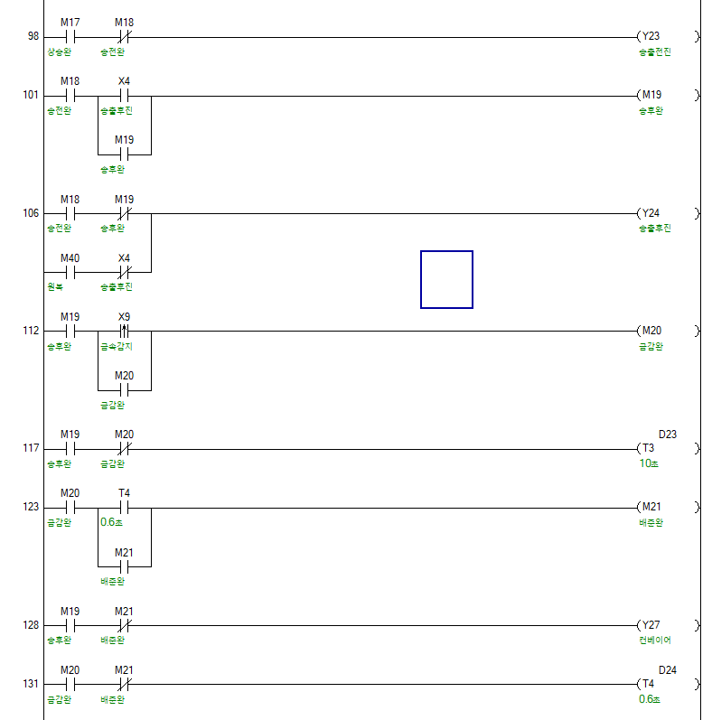
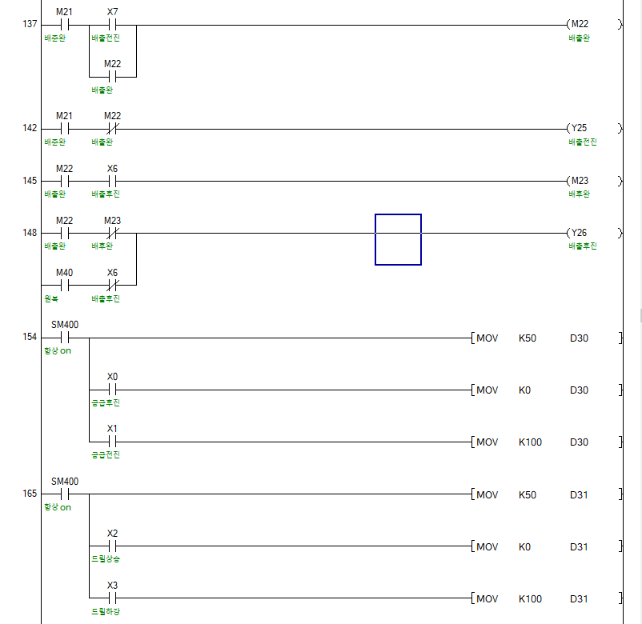
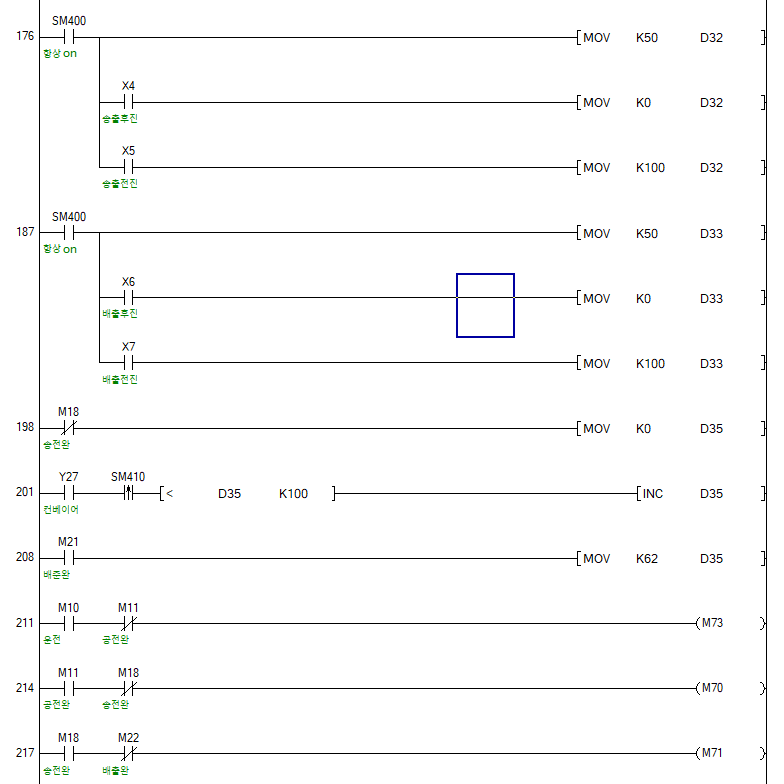
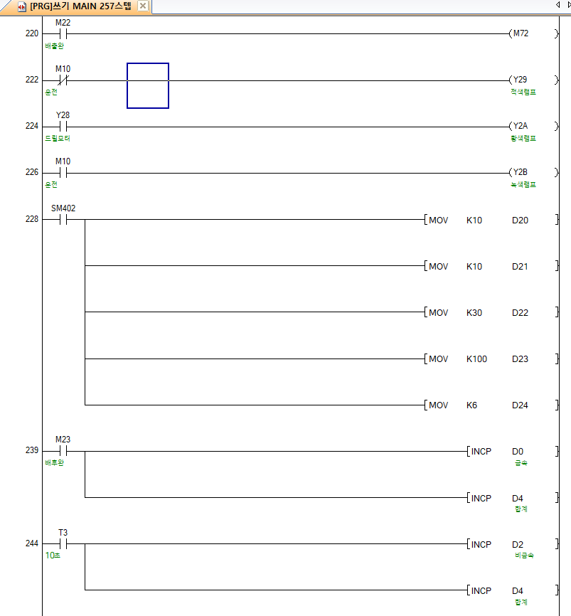
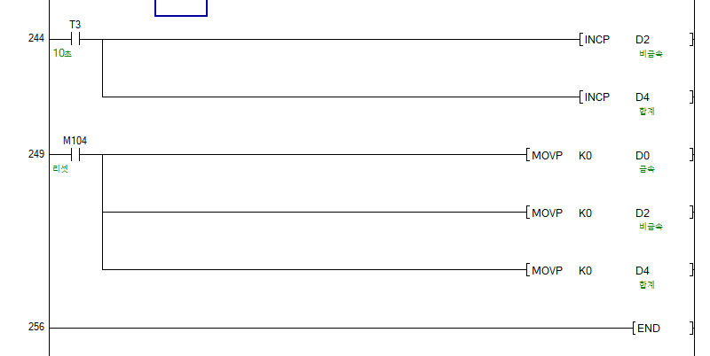

# 01. 래더 해설 — 금속/비금속 선별 라인 (평가 제출본, MAIN 257스텝)

> 소스: [`src/01_metal_sorting_line/metal_sorting_ladder_257step.gxw`](../src/01_metal_sorting_line/metal_sorting_ladder_257step.gxw) · GX Works2 (MELSEC Q)

과제로 받은 **I/O 매핑과 동작 플로우**를 그대로 시운전되도록 래더로 옮긴 것입니다.



---

## 1. 운전 준비 · 정지 · 원복 (스텝 0 ~ 24)



| 스텝 | 회로 | 의미 |
|---|---|---|
| 0 | `X0 · X2 · X4 · X6 → M0` | **원점(대기)** — 공급 후진 · 드릴 상승 · 송출 후진 · 배출 후진이 모두 확인될 때만 ON |
| 5 | `XC ∨ XD ∨ M103 ∨ M23 ∨ T3 ∨ M102 → M5` | **OFF 신호** — PB2/PB3, HMI 정지·리셋, 금속 배출 완료, 비금속 타임아웃 중 하나라도 들어오면 사이클 종료 |
| 12 | `(XD ∨ M103 ∨ M40) · /M0 · /M10 → M40` | **원복** — 정지 상태에서 원점이 아닐 때만 동작, 원점이 잡히면(M0) 자동 해제 |
| 18 | `((XB ∨ M100) · X8 · M0 ∨ M10) · /M5 → M10` | **운전** — PB1 또는 HMI 시작 + 매거진 적재 + 원점일 때 시작, 자기유지 |

`M10`은 이후 모든 단계 비트의 출발점입니다. `M5`가 들어오는 순간 `M10`이 떨어지고, 이어지는 완료 비트들(`M11`~`M23`)이 연쇄적으로 풀리면서 시퀀스가 초기화됩니다.

## 2. 공급 → 대기 → 드릴 가공 (스텝 25 ~ 73)




| 스텝 | 회로 | 의미 |
|---|---|---|
| 25 / 30 | `M10 · (X1 ∨ M11) → M11` / `M10 · /M11 → Y20` | 공급 전진, 전진 센서 X1로 **공전완** |
| 33 / 38 | `M11 · (T0 ∨ M12) → M12` / `M11 · /M12 → T0 D20` | 1초 대기 (설정값 D20) |
| 44 / 49 | `M12 · (T1 ∨ M13) → M13` / `M12 · /M13 → T1 D21` | 모터 회전 후 1초 대기 (D21) |
| 55 | `M13 · (X3 ∨ M14) → M14` | 드릴 하강 완료 |
| 60 / 65 | `M14 · (T2 ∨ M15) → M15` / `M14 · /M15 → T2 D22` | **가공 시간 3초** (D22) |
| 71 | `M12 · /M15 → Y28` | 드릴 모터는 *대기 완료 ~ 가공 완료* 구간 동안 회전 |
| 74 | `M15 · (X0 ∨ M16) → M16` | 공급 후진 완료 |
| 79 | `M13 · /M16 → Y22` | 드릴 하강 (편솔) — 공급 후진이 끝나면 OFF → 스프링 복귀로 상승 |
| 82 | `M15 · /M16 ∨ M40 · /X0 → Y21` | 공급 후진 (원복 때도 같은 코일 사용) |

## 3. 송출 → 컨베이어 → 금속 배출 (스텝 88 ~ 153)




| 스텝 | 회로 | 의미 |
|---|---|---|
| 88 | `M16 · (X2 ∨ M17) → M17` | 드릴 상승 완료 |
| 93 / 98 | `M17 · (X5 ∨ M18) → M18` / `M17 · /M18 → Y23` | 송출 전진 |
| 101 / 106 | `M18 · (X4 ∨ M19) → M19` / `M18 · /M19 ∨ M40 · /X4 → Y24` | 송출 후진 (원복 겸용) |
| 112 | `M19 · (X9↑ ∨ M20) → M20` | **금속 감지** — 상승 펄스(`LDP`)로 1회만 인식 |
| 117 | `M19 · /M20 → T3 D23` | 금속이 10초 동안 안 들어오면 **비금속 통과**로 판단 |
| 123 / 131 | `M20 · (T4 ∨ M21) → M21` / `M20 · /M21 → T4 D24` | 금속 감지 후 0.6초 뒤 배출 위치 도달 |
| 128 | `M19 · /M21 → Y27` | 컨베이어 — 송출 후진 완료 ~ 배출 준비 완료 |
| 137 / 142 | `M21 · (X7 ∨ M22) → M22` / `M21 · /M22 → Y25` | 배출 전진 |
| 145 / 148 | `M22 · (X6 ∨ M23) → M23` / `M22 · /M23 ∨ M40 · /X6 → Y26` | 배출 후진 (원복 겸용) |

## 4. HMI 애니메이션 · 표시 · 카운트 (스텝 154 ~ 256)





| 스텝 | 회로 | 의미 |
|---|---|---|
| 154 ~ 197 | `SM400 → MOV K50 Dn`, 후진센서 → `K0`, 전진센서 → `K100` | 실린더 위치값 `D30` 공급 · `D31` 드릴 · `D32` 송출 · `D33` 배출 → HMI 부품 위치 |
| 198 | `/M18 → MOV K0 D35` | 송출 전에는 공작물 위치 0 |
| 201 | `Y27 · SM410↑ · [D35 < K100] → INC D35` | 컨베이어가 도는 동안 공작물 아이콘 이동 |
| 208 | `M21 → MOV K62 D35` | 금속은 배출 위치(62)에서 정지 |
| 211 ~ 220 | `M73 / M70 / M71 / M72` | 공정 단계(공급 · 가공 · 이송 · 배출) 표시 비트 |
| 222 ~ 226 | `/M10 → Y29`, `Y28 → Y2A`, `M10 → Y2B` | 경광등 — 정지 적색 · 모터 황색 · 운전 녹색 |
| 228 | `SM402 → MOV K10 D20, K10 D21, K30 D22, K100 D23, K6 D24` | 전원 투입 첫 스캔에 타이머 초기값(0.1s 단위) |
| 239 | `M23 → INCP D0, INCP D4` | 금속 / 합계 카운트 |
| 244 | `T3 → INCP D2, INCP D4` | 비금속 / 합계 카운트 |
| 249 | `M104 → MOVP K0 D0, D2, D4` | HMI 카운트 리셋 |

---

## 5. 연습 버전과 비교 — 연속 운전 래치 (MAIN 115스텝)

평가 전에 같은 장비로 먼저 만든 연습 버전은 **연속/단속 운전**을 지원했습니다. (입력: `XB` 단속 · `XC` 연속 · `XD` 연속정지 · `XE` 리셋)

```text
0   SM402 ─────────────────────────────── MOV K30 D10        가공시간 초기값 3.0s
3   (XC ∨ M0 ∨ M101) · /XD · /M102 ────── (M0)               연속 운전 래치
9   (XB ∨ M0 ∨ M1 ∨ M100) · /M7 ───────── (M1)               사이클 진행
15  M1 · X8 · /M5 · /X1 ───────────────── (Y20)              공급 전진
44  T1 · X2 · /M2 ─────────────────────── (T2 D10)           드릴 하강 후 가공시간 카운트
60  X5 ∨ (M1 · Y27) ───────────────────── (Y27) (T3 K100)    컨베이어 + 10초 타이머
69  T3 · /M8 ──────────────────────────── (M7)               사이클 종료 → 연속이면 M0로 재시작
72  (X9↑ ∨ M8) · /Y26 ─────────────────── (M8) (T4 K6)       금속 감지 → 0.6초 후 배출
86  Y28 · SM412 ───────────────────────── (Y2A)              모터 가동 중 황색 1초 점멸
95  X9 → INCP D0, D4  /  XA · /M20 → INCP D2, D4             금속·비금속 센서로 직접 카운트
```

| | 연습 버전 (115스텝) | 평가 버전 (257스텝) |
|---|---|---|
| 구조 | 센서·타이머를 직접 엮은 조건식 | 단계별 **완료 비트 래치** |
| 운전 모드 | 단속 + **연속** | 단속 (1사이클) |
| 비금속 판정 | `XA` 비금속 센서로 카운트 | 10초 타임아웃 |
| HMI | 버튼 4개 + 가공시간 1개 | 타이머 5개 설정 · 2D 트윈 · 공정 진행 표시 |
| 원복 | 리셋은 카운트만 | 원점 인터록 + 원복 시퀀스 |

두 버전의 장점을 합치는 것(완료 비트 구조 + 연속 운전 + XA 확인 + 단계 타임아웃 알람 + 일시정지)이 다음 개선 목표입니다.
