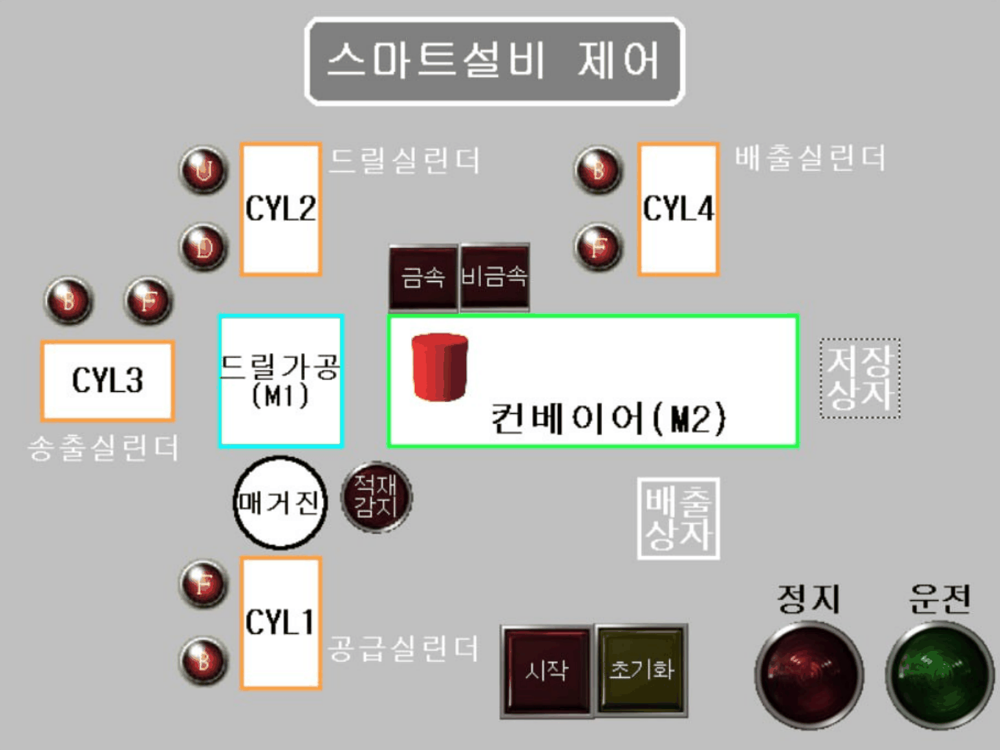
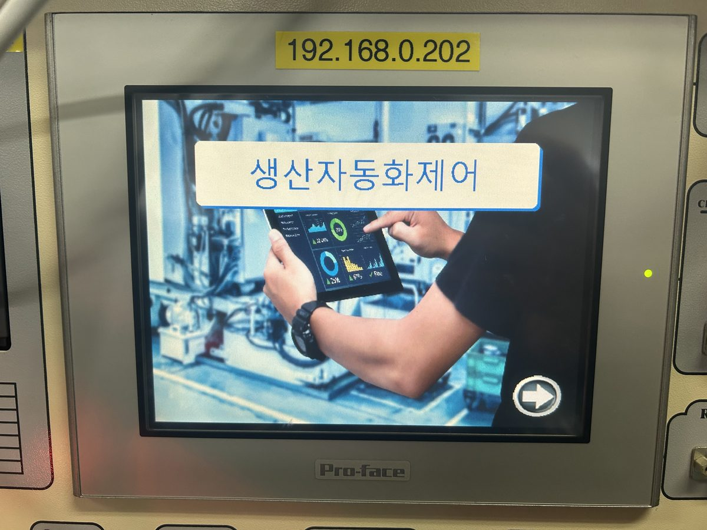
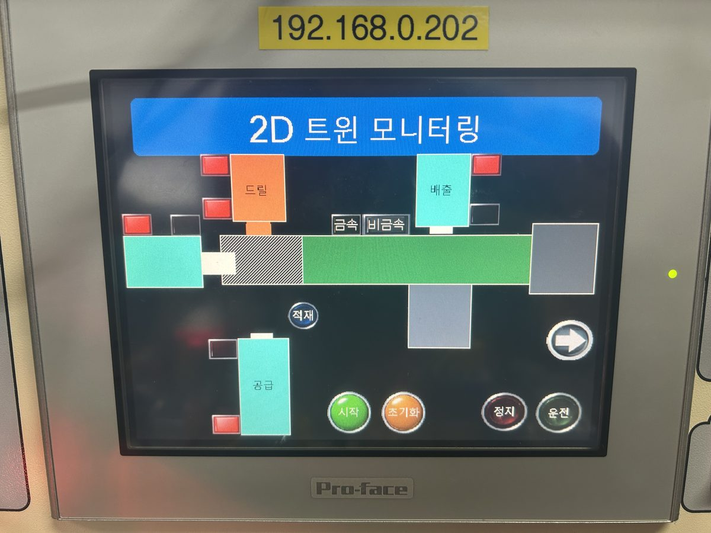
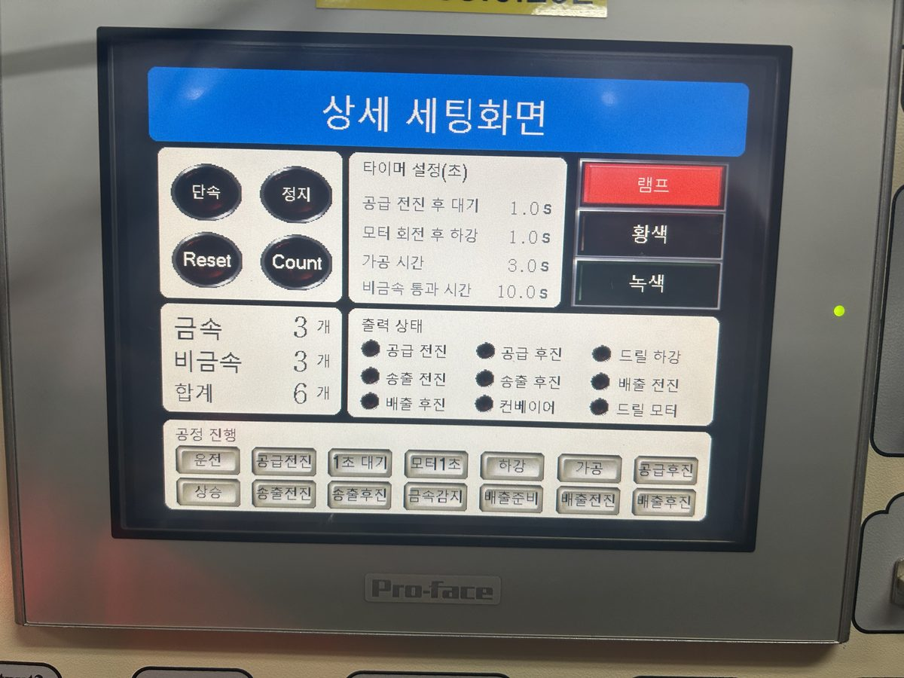
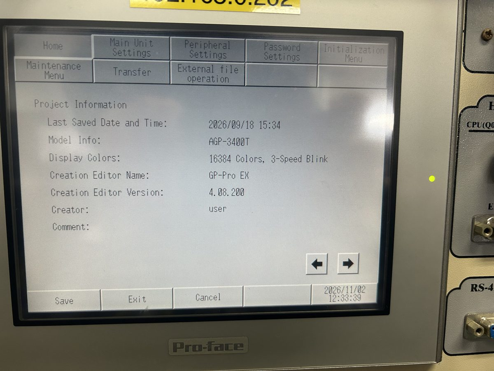
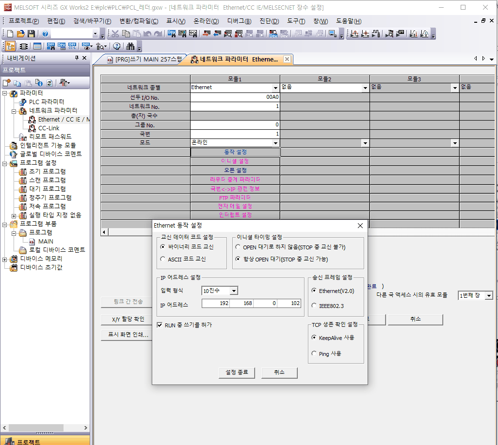
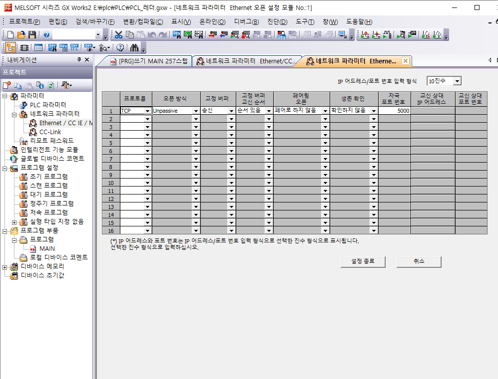
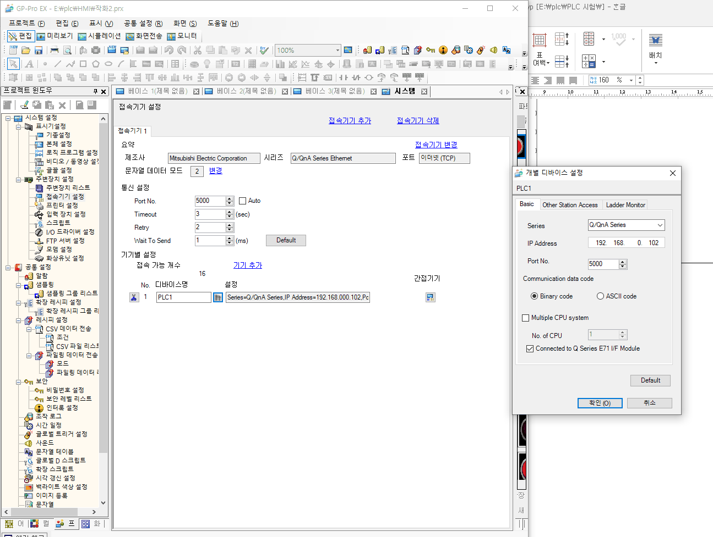

# 02. HMI 작화 & PLC 통신

> 소스: [`src/01_metal_sorting_line/metal_sorting_hmi.prx`](../src/01_metal_sorting_line/metal_sorting_hmi.prx) · GP-Pro EX 4.08 · Pro-face AGP-3400T (16384색)

## 과제 사양

과제는 "아래 그림처럼 작화해 터치패널에 전송하되, 텍스트·버튼·램프의 개수와 배치는 수험자 판단으로 균형 있게"였습니다.

예시는 한 화면에 모든 요소를 넣는 형태였지만, 실제 작화에서는 **용도별로 3화면**으로 나눴습니다.

## 화면 구성

| 화면 | 구성 요소 | 연결 디바이스 |
|---|---|---|
| **① 타이틀** "생산자동화제어" | 배경 이미지, 다음 화면 버튼 | 화면 전환 |
| **② 2D 트윈 모니터링** | 공급 · 드릴 · 송출 · 배출 실린더 부품, 컨베이어, 공작물 아이콘, 금속/비금속 표시, 적재 램프, 시작 · 초기화 버튼, 정지 · 운전 램프 | `D30~D33` 실린더 위치, `D35` 공작물 위치, `X8` 적재, `M100` 시작, `M103` 초기화, `Y29/Y2B` 램프 |
| **③ 상세 세팅** | 단속 · 정지 · Reset · Count 버튼, 타이머 설정 4종, 적/황/녹 램프, 금속 · 비금속 · 합계, 출력 상태 9종, 공정 진행 표시 13단계 | `M100/M102/M103/M104`, `D20~D23`, `D0/D2/D4`, `Y20~Y2B`, 단계 완료 비트 |

<table>
  <tr>
    <td></td>
    <td></td>
  </tr>
  <tr>
    <td></td>
    <td></td>
  </tr>
</table>

### 설계 포인트

- **타이머 설정값을 HMI에서 입력** — 데이터 표시기(입력 허용)를 `D20~D23`에 연결하고, 0.1초 단위 정수를 소수점 1자리로 표시. 전원 투입 시에는 PLC의 `SM402`가 기본값을 넣어 줍니다.
- **2D 트윈** — 부품 위치를 PLC가 계산한 `0 / 50 / 100` 값으로 바꿔 움직이게 해서, HMI 쪽 로직 없이 PLC 데이터만으로 화면이 따라오게 했습니다.
- **공정 진행 표시** — 각 단계의 완료 비트를 램프로 연결해 현재 위치를 한눈에 확인. 래더 모니터링 없이도 어디서 멈췄는지 알 수 있습니다.
- **모멘터리 버튼** — 시작 · 정지 · 리셋 · 카운트 리셋은 누르는 동안만 ON되는 비트 스위치로 두고, 유지는 PLC 자기유지 회로가 담당.

## 통신 설정 — MELSEC Q (QJ71E71-100) ↔ AGP-3400T

| 항목 | PLC 쪽 (GX Works2 네트워크 파라미터) | HMI 쪽 (GP-Pro EX 접속기기) |
|---|---|---|
| 기종 | Ethernet / 네트워크 No.1 | Mitsubishi Electric · Q/QnA Series Ethernet |
| IP | `192.168.0.102` | 자기 `192.168.0.202` → 상대 `192.168.0.102` |
| 포트 | 오픈 설정 1번: **TCP · Unpassive · 고정 버퍼 송신 · 자국 포트 5000** | Port `5000` |
| 코드 | 바이너리 코드 교신 | Binary code |
| 기타 | RUN 중 쓰기 허가 · 항상 OPEN 대기 | Timeout 3s · Retry 2 · Wait To Send 1ms · *Connected to Q Series E71 I/F Module* |

<table>
  <tr>
    <td></td>
    <td></td>
  </tr>
</table>

### 연동 체크포인트

- 이더넷 설정은 네트워크 파라미터에 들어 있으므로, 프로그램뿐 아니라 **파라미터도 PLC에 써야** 적용됩니다.
- HMI 버튼이 쓰는 `M` 영역은 `M100번대`로 따로 잡아, 래더 내부 릴레이(`M0~M73`)와 겹치지 않게 했습니다.
- 첫 연동 실습(11/02)은 [`src/02_plc_hmi_link`](../src/02_plc_hmi_link)에 있습니다.
