# 03. 기초 실습 — 릴레이 시퀀스에서 PLC 래더까지

공정 라인 래더 전에 거친 기초 실습들입니다. 릴레이 회로로 원리를 익히고, 같은 문제를 GX Works2 래더로 다시 풀었습니다.

## 1. 릴레이 · 공압 시퀀스 (PH-Lab, 10.12 – 10.14)

> 소스: [`src/04_phlab_relay_sequence`](../src/04_phlab_relay_sequence) (`.phl`, PH-Lab)

| 주제 | 실습 문제 |
|---|---|
| a/b접점 AND · OR | 버튼 조합에 따라 램프 1~4 점등/소등 (4문제) |
| 자기유지 · 인터록 | 한 번 누르면 유지, 정지 우선 · 상호 배제 |
| 선입 우선 (퀴즈쇼) | 패널 3개 중 **먼저 누른 사람만** 램프 유지, 사회자 초기화 |
| 후입 우선 | **마지막에 누른 버튼만** 유지, 앞 램프는 소등 |
| 타이머 | 2초 뒤 점등 유지 / 즉시 점등 3초 유지 / 1초 간격 순차 점등·소등 / 2.5초 지연 → 4.2초 유지 반복 |
| 카운터 | 누를 때마다 램프 누적 점등 / 해당 램프만 이동 점등 |
| 실린더 | 편솔 전진·후진 유지, 왕복 버튼을 누르고 있어도 **완전 복귀 후 재전진**하는 안전 회로 |
| 연속 · 단속 · 정지 | 무한 왕복 / 1회 왕복 / 연속 정지 — 편솔과 양솔레노이드 각각 구현 |
| 2실린더 시퀀스 | `A+ B+ B- A-`, `A+ B+ A- B-` (리밋스위치 LS1~LS4) |

<table>
  <tr>
    <td width="50%">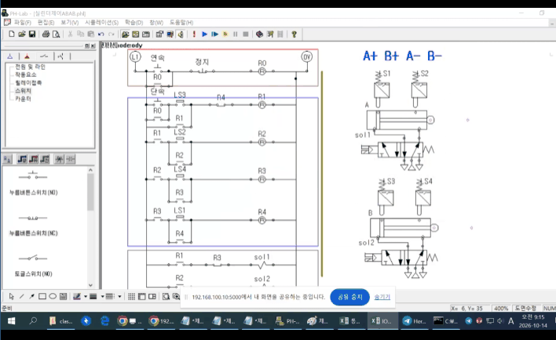</td>
    <td width="50%">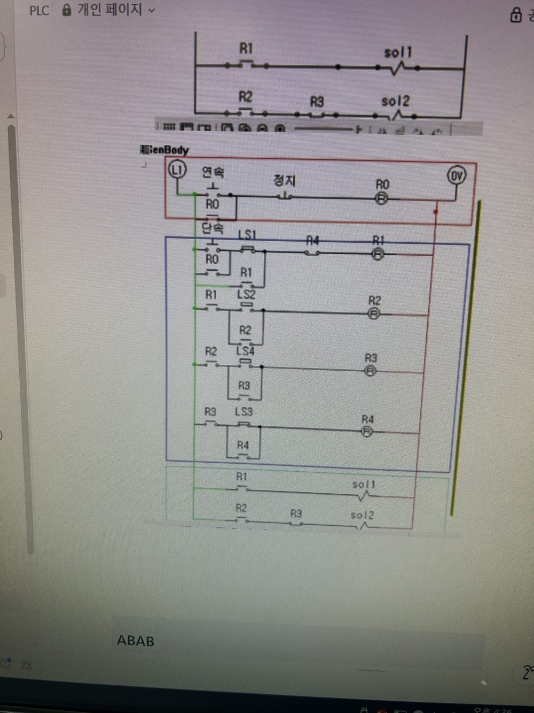</td>
  </tr>
  <tr>
    <td align="center">PH-Lab: 릴레이 회로(왼쪽)와 공압 실린더·밸브(오른쪽) 동시 시뮬레이션</td>
    <td align="center">단계 릴레이 R1~R4로 만든 2실린더 시퀀스</td>
  </tr>
  <tr>
    <td>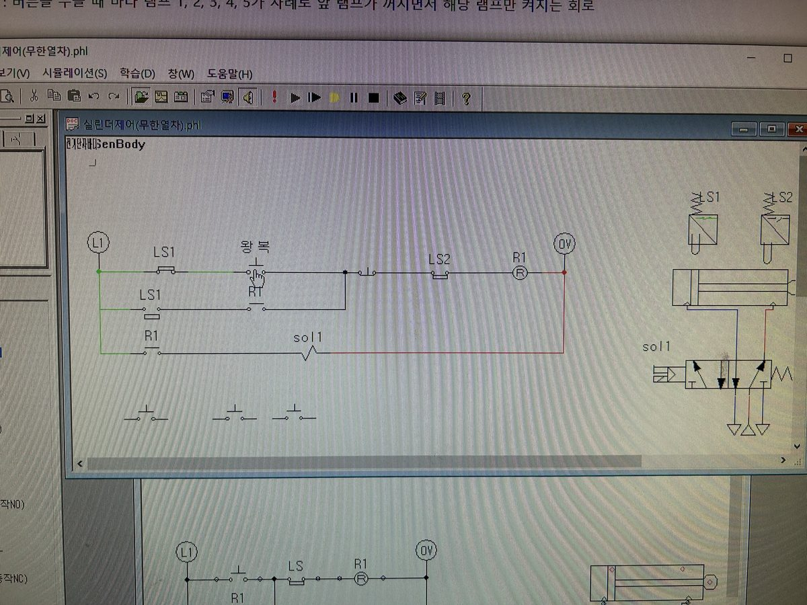</td>
    <td>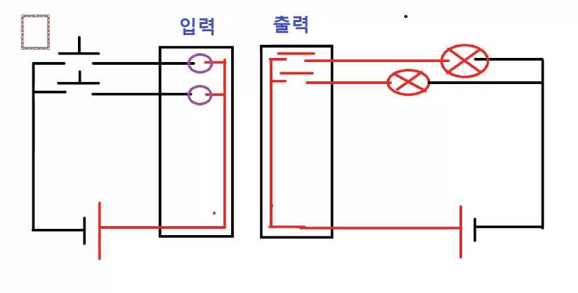</td>
  </tr>
  <tr>
    <td align="center">왕복 버튼 안전 회로 (편솔)</td>
    <td align="center">입력·출력으로 나눠 그려 본 자기유지 원리</td>
  </tr>
</table>

## 2. GX Works2 래더 입문 (10.14 –)

> 소스: [`src/03_gxworks2_basics`](../src/03_gxworks2_basics)

- **주소 체계**: 미쓰비시는 `X` 입력 · `Y` 출력 · `M` 내부릴레이, 16점 단위 16진수(`X00~X0F`, `Y20~Y2F`) — 지멘스의 `I/Q/M` 표준 표기와 비교하며 정리
- **편집 흐름**: `F2` 쓰기 → `F4` 변환(컴파일) → PLC 쓰기 → `F3` 모니터링, 변환 전 회색 회로는 "편집됐지만 미적용" 상태
- **특수 릴레이**: `SM400` 상시 ON, `SM402` RUN 후 1스캔 ON(초기값), `SM409~SM413` 클록(점멸)

<table>
  <tr>
    <td width="50%">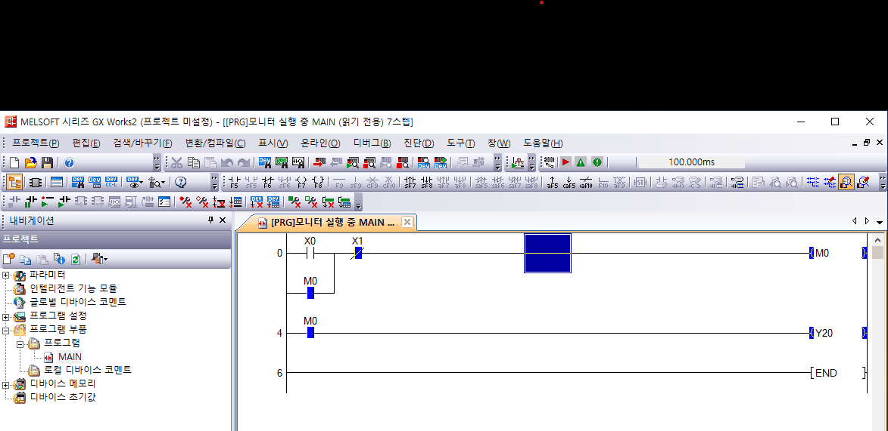</td>
    <td width="50%">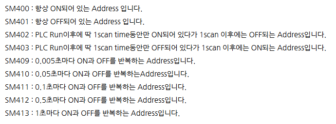</td>
  </tr>
</table>

## 3. 수위 제어 + 센서 이상 검출 (10.19)

> 소스: [`water_level_type1.gxw`](../src/03_gxworks2_basics/water_level_type1.gxw) · [`water_level_type2_error_detect.gxw`](../src/03_gxworks2_basics/water_level_type2_error_detect.gxw)

| 수위 | 모터1 `Y20` | 모터2 `Y21` | 적색 `Y22` | 부저 `Y23` | 녹색(만수) `Y24` |
|---|---|---|---|---|---|
| 고수위 `X0` | OFF | OFF | OFF | OFF | **ON** |
| 중수위 `X1` | ON | OFF | ON | OFF | OFF |
| 저수위 `X2` | ON | ON | **1초 점멸** | **1초 점멸** (`SM412`) | OFF |

**방식 1 → 방식 2로 개선한 점**

1. 조건을 출력에 바로 연결하던 방식에서 **제어부(내부릴레이 `M20~M23`) / 출력부(`Y`)를 분리** — 같은 출력을 여러 조건이 켜도 코일이 한 번만 나오도록 정리
2. **센서 이상 검출** — 고수위가 ON인데 중·저수위가 OFF처럼 *물리적으로 불가능한 센서 조합* 5가지를 `M10 에러`로 묶고, 에러 시 `Y31` 에러램프 점멸 + `M12 Ready`를 끊어 펌프 제어 전체를 인터록

<table>
  <tr>
    <td width="33%">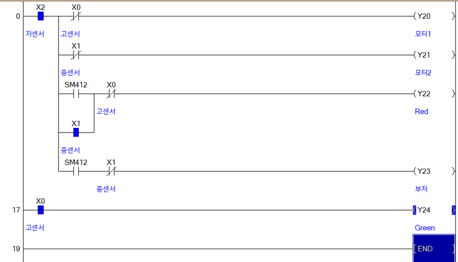</td>
    <td width="33%">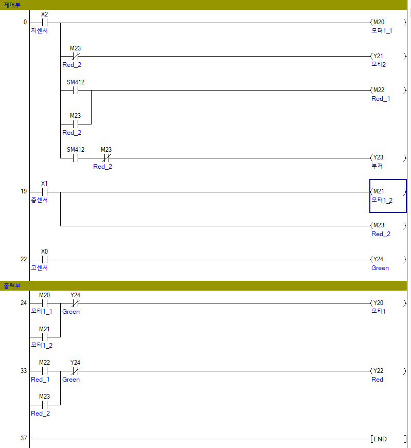</td>
    <td width="33%">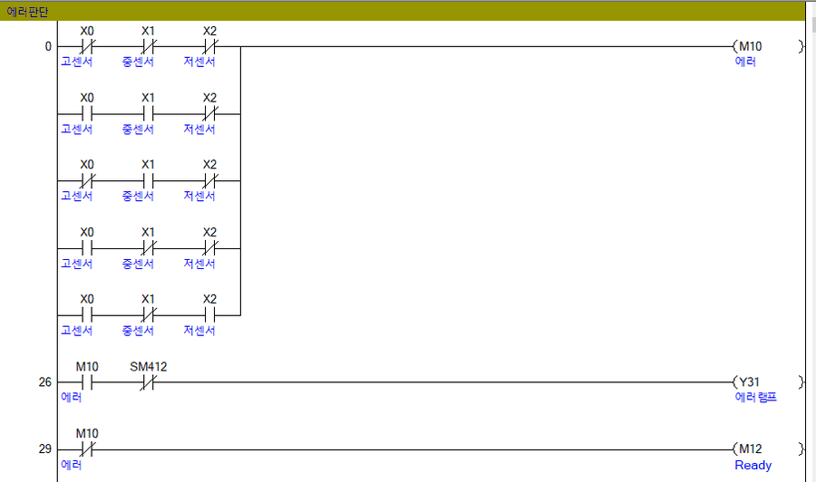</td>
  </tr>
  <tr>
    <td align="center">방식 1</td>
    <td align="center">제어부 / 출력부 분리</td>
    <td align="center">센서 이상 → 에러 · Ready 인터록</td>
  </tr>
</table>

> 이 센서 이상 검출 아이디어를 공정 라인의 **단계별 타임아웃 알람**으로 확장하는 것이 다음 개선 과제입니다.

## 4. 공정 스테이션 I/O 매핑 (10.19 – 10.20)

엑셀로 입력 · 출력 · 동작 순서를 먼저 정리하고 배선한 뒤 래더를 작성했습니다.

<table>
  <tr>
    <td width="50%">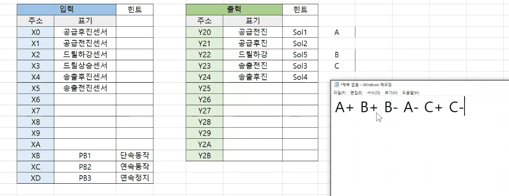</td>
    <td width="50%">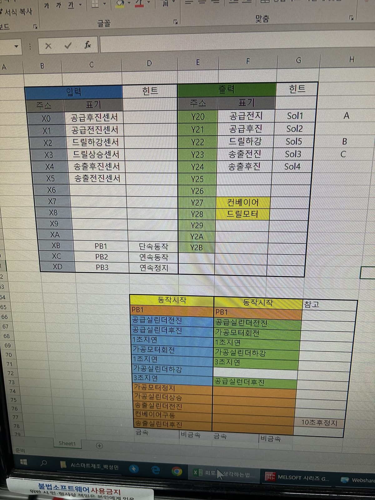</td>
  </tr>
  <tr>
    <td>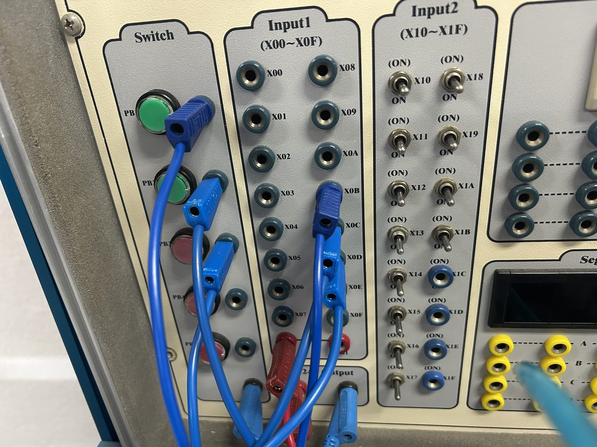</td>
    <td>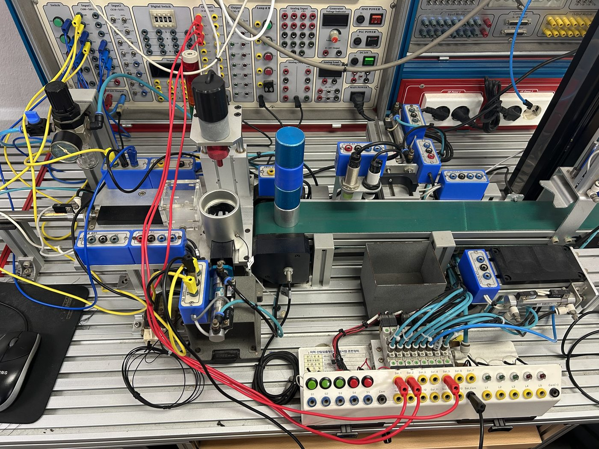</td>
  </tr>
</table>

배선 규칙: 제어선 **노란색** · +극 **빨간색** · −극 **검정/파란색**
